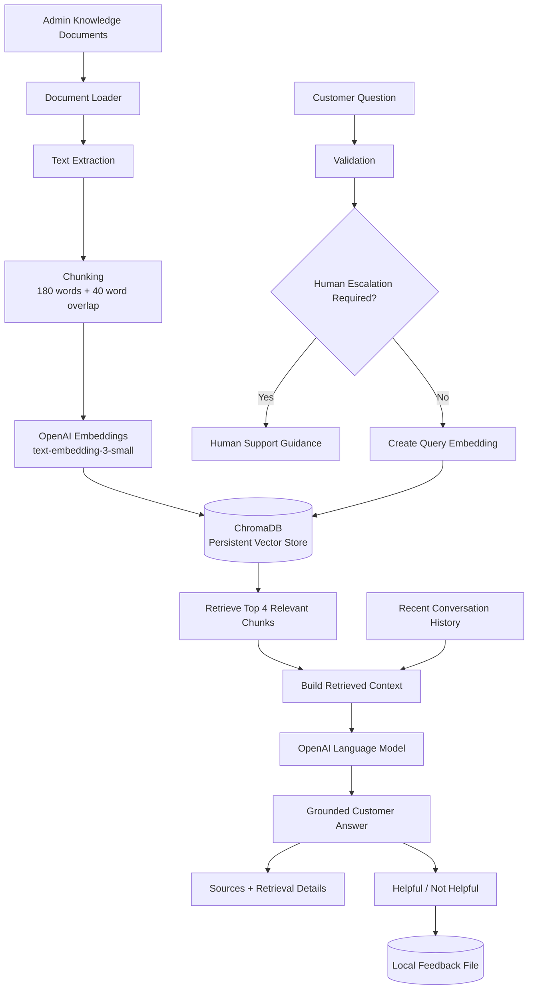

# NovaMart AI Customer Support Assistant

An AI-powered customer-support knowledge assistant that answers questions from a company's support documents, shows its sources, and hands off to a human when it can't help.

**[Live demo](https://novamart-support-assistant-izoskpjujfgtgakmwwh9uv.streamlit.app/)** | [Evaluation results](evaluation/results.md)


> NovaMart is a fictional store. All policies, addresses, phone numbers, and other business details in this project are made up for demonstration. The live demo runs on free hosting, so the first load can take about 30 seconds if the app has been idle.

## Highlights

- Retrieval-Augmented Generation (RAG) built directly with Python, ChromaDB, and the OpenAI API, without LangChain or LlamaIndex
- Semantic search over nine support documents, with source citations on every answer
- Conversation memory so follow-up questions make sense
- Deterministic human escalation for orders, refunds, payments, and account issues, so the assistant never pretends to perform actions it can't
- Customer feedback collection (Helpful / Not helpful)
- Password-protected admin page to add, replace, and remove knowledge-base documents
- Evaluated on 20 test questions: **X/20 answered correctly** (see [evaluation/results.md](evaluation/results.md))
- Automated tests with pytest

## Contents

1. [Business problem](#business-problem)
2. [How it works](#how-it-works)
3. [Tech stack](#tech-stack)
4. [Project structure](#project-structure)
5. [Run it locally](#run-it-locally)
6. [Key design decisions](#key-design-decisions)
7. [Escalation and safety](#escalation-and-safety)
8. [Admin area](#admin-area)
9. [Testing and evaluation](#testing-and-evaluation)
10. [Known limitations](#known-limitations)
11. [Future improvements](#future-improvements)

## Business problem

NovaMart is a fictional growing online retailer that receives the same support questions again and again: delivery, returns, refunds, payments, warranties, order cancellation, account and password help, opening hours, and complaints. The answers already exist in policy documents, but staff spend time finding and restating them.

This assistant searches NovaMart's approved knowledge base and generates grounded answers. It answers informational questions only. It has no access to private customer, payment, account, or order systems.

## How it works



1. The question is validated.
2. Requests that clearly need a human are detected and escalated.
3. Otherwise, the question is converted into an embedding.
4. ChromaDB retrieves the four most relevant document chunks.
5. The chunks and recent conversation history are sent to the language model.
6. The model answers using the retrieved information and is told not to invent policies.
7. The answer is shown with its sources, and the customer can rate it.

If the knowledge base doesn't contain the answer, the assistant says so and points the customer to human support instead of guessing.

## Tech stack

| Tool | Purpose |
|---|---|
| Python | Application and backend logic |
| Streamlit | Customer and admin web interface |
| OpenAI API | Embeddings and response generation |
| ChromaDB | Local vector database |
| python-dotenv | Environment variable management |
| pypdf | PDF text extraction |
| pytest | Automated testing |

## Project structure

```text
novamart-support-assistant/
├── app.py
├── config.py
├── pytest.ini
├── src/
│   ├── document_loader.py
│   ├── chunking.py
│   ├── embeddings.py
│   ├── vector_store.py
│   ├── ingestion.py
│   ├── retrieval.py
│   ├── assistant.py
│   ├── escalation.py
│   ├── validation.py
│   └── feedback.py
├── data/
│   ├── documents/      # nine fictional policy documents
│   ├── chroma/         # local vector database (not in Git)
│   └── feedback/       # local feedback file (not in Git)
├── tests/
├── evaluation/
├── .env.example
├── requirements.txt
└── README.md
```

## Run it locally

```bash
git clone https://github.com/Frank-Enebeli/novamart-support-assistant.git
cd novamart-support-assistant
python -m venv .venv
```

Activate the virtual environment:

```powershell
# Windows PowerShell
.venv\Scripts\Activate.ps1

# Mac/Linux
source .venv/bin/activate
```

Install dependencies:

```bash
python -m pip install -r requirements.txt
```

Create a `.env` file in the project root (see `.env.example`):

```text
OPENAI_API_KEY=your_openai_api_key_here
ADMIN_PASSWORD=choose_a_long_unique_password
```

Never commit `.env` to Git. If `ADMIN_PASSWORD` is not set, the admin area stays locked.

Index the knowledge base, then start the app:

```bash
python -m src.ingestion
streamlit run app.py
```

The app opens at `http://localhost:8501`. Documents that are already indexed are skipped, so re-running ingestion is safe.

**On Streamlit Cloud**, add the same values under **Manage app > Settings > Secrets**:

```toml
OPENAI_API_KEY = "your_openai_api_key_here"
ADMIN_PASSWORD = "choose_a_long_unique_password"
```

## Key design decisions

| Decision | Choice | Reason |
|---|---|---|
| Framework | No RAG framework | Each part of the pipeline (loading, chunking, embedding, retrieval, prompting) is implemented directly so it can be understood and explained |
| Chunking | 180 words, 40-word overlap | Keeps chunks focused while preserving policy context across boundaries. A starting point, not assumed optimal |
| Embeddings | `text-embedding-3-small` | Same model for documents and queries so vectors are comparable |
| Retrieval | Top 4 chunks | Some questions need more than one document, for example a cancellation plus its refund timing |
| History | Last 6 messages | Enough for follow-ups without sending the whole conversation |
| Vector store | ChromaDB, local persistent | Simple Python interface with local persistence |
| Escalation | Rules in Python | Operational and security-sensitive requests shouldn't depend on the model alone |

<details>
<summary>More detail on retrieval, sources, and missing information</summary>

**Retrieval distance.** ChromaDB returns a distance for each chunk. A lower distance means a closer match, but it is not a percentage. It is used for ranking and evaluation only.

**Metadata.** Every chunk stores its source file, category, and chunk number, which lets the app show where information came from and manage documents individually.

**Missing information.** A vector database returns the nearest chunks even when none answers the question. For example, a question about Bitcoin may retrieve the payments policy, which says nothing about cryptocurrency. The model is instructed not to assume either answer and to say it couldn't find enough information.

**Supported files.** Markdown, TXT, and PDF. Scanned PDFs are not supported because there is no OCR.

</details>

## Escalation and safety

The assistant escalates to human-support guidance for:

- requests to speak to a person, and complaints
- payment disputes, unknown charges, and account-security concerns
- private order-status requests
- requests to cancel an order, issue a refund, or reset or change an account

For example, "Where is my order NM-45882?" does not produce a made-up tracking answer. The assistant explains that it can't access live order information and gives the fictional support contact details.

**Other safeguards**

- Questions are validated: empty input is rejected and length is capped at 1,000 characters.
- Uploads are validated by type and size in the backend, and filenames are sanitized.
- The OpenAI key lives in `.env` or Streamlit secrets and is never placed in the model prompt or feedback file.
- The model is instructed to treat customer input and retrieved text as untrusted data, and to ignore instructions to reveal its prompt, change roles, or invent policies.
- Customers see safe messages instead of Python tracebacks.

Prompt instructions are not a complete security boundary. Security also depends on the design: the assistant holds no secrets and has no access to private systems.

## Admin area

The admin page lets an administrator:

- view indexed documents and chunk counts
- upload `.md`, `.txt`, or `.pdf` files (maximum 2 MB)
- replace and re-index an existing document, or remove one
- view a summary of customer feedback

The page is protected by a shared password read from `ADMIN_PASSWORD`. Failed attempts are limited per session. Upload and delete actions also check that the admin is logged in.

## Testing and evaluation

Run the tests with:

```bash
python -m pytest -v
```

The tests cover input validation, upload validation, conversation history, retrieval, missing-information handling, API failure handling, source inclusion, escalation, prompt-injection behavior, and feedback storage. External API calls are mocked, so the tests are fast and cost nothing.

**Evaluation.** The assistant was tested with 20 questions:

| Type | Count |
|---|---|
| Direct policy questions | 5 |
| Paraphrased questions | 5 |
| Multi-document questions | 3 |
| Unavailable-information questions | 3 |
| Ambiguous questions | 2 |
| Prompt-injection attempts | 2 |

Each question was run independently without conversation history. Results record the expected and actual source, the generated answer, correctness, and notes. See [evaluation/results.md](evaluation/results.md), or re-run it with:

```bash
python -m evaluation.run_evaluation
```

A correct source being retrieved does not guarantee a correct answer, so both retrieval and the final response are checked.

## Known limitations

**Shared-password admin access.** The admin area uses one shared password stored in an environment variable or Streamlit secret. If none is configured, the area stays locked. This is a basic gate, not full authentication: there are no user accounts, roles, audit logs, or password reset, and the login attempt limit is tracked per browser session, so it is not a substitute for server-side rate limiting.

**Temporary storage on the hosted demo.** On free hosting, documents uploaded through the admin page and stored feedback are lost when the app restarts. The bundled NovaMart documents are re-indexed automatically.

**Hosting.** The free tier can put the app to sleep when idle, so the first request after a quiet period can be slow.

**No live customer systems.** The assistant cannot track orders, access accounts, inspect payments, issue refunds, cancel orders, or change passwords. These requests are escalated.

**Keyword-based escalation.** Some escalation cases use regular expressions, so unusual phrasing may not always trigger them.

**Prompt-injection risk.** Prompt instructions reduce the risk but cannot guarantee resistance to adversarial input.

**Simple chunking.** Documents are split by word count, not by headings or meaning.

**No OCR.** Scanned or image-only PDFs can't be read.

**Local feedback storage.** Feedback goes to a local JSON Lines file, not a production database.

**No automated source verification.** The app shows retrieved sources but does not verify that every generated sentence is supported by them.

**Public demo and API usage.** The demo uses a personal OpenAI key. Input limits and account spending controls reduce the risk, but a public demo can still consume credits.

## Future improvements

- User accounts and role-based permissions for the admin area
- Managed vector database and a persistent database for feedback
- Heading-aware or semantic chunking, and reranking of retrieved chunks
- Retrieval-distance thresholds and stronger source-attribution checks
- OCR for scanned PDFs
- Logging, monitoring, and analytics on common and unanswered questions
- Admin review of "Not helpful" feedback
- Human-agent handoff and integration with authorized order and account APIs
- Streaming responses and automated evaluation runs
- Document version tracking and background re-indexing

## Disclaimer

NovaMart is a fictional business created for an educational project. All policies, addresses, phone numbers, email addresses, delivery terms, refund terms, warranty conditions, and other business information are fictional and do not represent a real company.

## Author

Frank Enebeli
[GitHub](https://github.com/Frank-Enebeli) | [LinkedIn](https://www.linkedin.com/in/frank-enebeli-7aa900b2/) | [enebelifrank@gmail.com](mailto:enebelifrank@gmail.com)