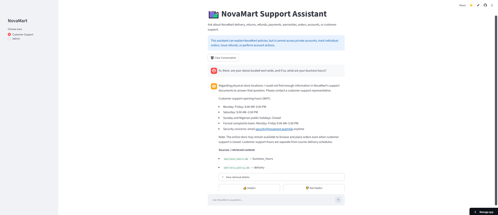

# NovaMart Support Assistant

An AI-powered customer-support knowledge assistant that answers questions from a company's support documents, shows its sources, and hands off to a human when it can't help.

**[Live demo](https://novamart-support-assistant-izoskpjujfgtgakmwwh9uv.streamlit.app/)**

> NovaMart is a fictional store. All support documents in this project are made up for demonstration. The first load of the live demo can take about 30 seconds if the app has been idle.



## What it does

- Answers customer questions using the support documents in its knowledge base
- Finds relevant information with semantic search instead of keyword matching
- Remembers recent conversation so follow-up questions make sense
- Shows which source documents each answer came from
- Escalates requests that need a human
- Collects customer feedback on answers
- Includes an admin page to add and manage knowledge-base documents

## How it works

1. Support documents are split into chunks and turned into embeddings with the OpenAI API.
2. The embeddings are stored in ChromaDB.
3. When a customer asks a question, the app retrieves the most relevant chunks.
4. The OpenAI model answers using only that retrieved context, along with recent chat history.
5. The answer is shown with its sources, or the request is escalated to a human if the documents don't cover it.

## Tech stack

Python, Streamlit, OpenAI API, ChromaDB

## Run it locally

```bash
git clone https://github.com/Frank-Enebeli/novamart-support-assistant.git
cd novamart-support-assistant
python -m venv venv
venv\Scripts\activate        # Mac/Linux: source venv/bin/activate
pip install -r requirements.txt
```

Create a `.env` file in the project root:

```
OPENAI_API_KEY=your-key-here
```

Then start the app:

```bash
streamlit run app.py
```

## Limitations

- The live demo runs on free hosting, so documents added through the admin page are lost when the app restarts. The sample knowledge base is rebuilt on each start.
- Answers are only as good as the documents provided. If the information isn't in the knowledge base, the assistant should escalate rather than guess.

## Author

Frank Enebeli
[GitHub](https://github.com/Frank-Enebeli) | [LinkedIn](https://www.linkedin.com/in/frank-enebeli-7aa900b2/) | enebelifrank@gmail.com